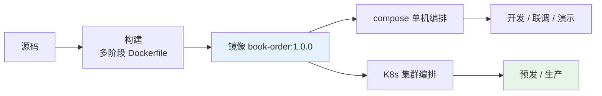
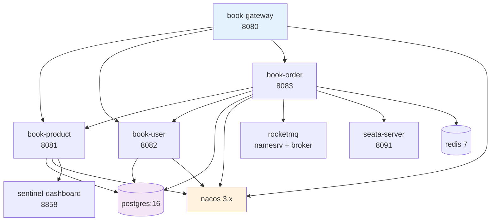
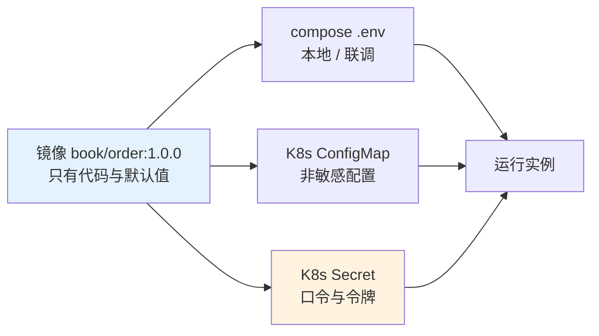

# 容器化部署与生产实践

## 课程目标

- 理解容器化解决的三个问题：环境一致性、弹性伸缩、交付效率，并能判断哪些场景不适合容器化
- 掌握四个服务统一的 Dockerfile 写法：多阶段构建、非 root、时区、内存比例参数、健康检查
- 能够用一份 `docker-compose.yml` 编排全部中间件与业务服务，并让启动顺序由健康检查决定
- 掌握配置外置：用环境变量覆盖 Spring 配置，做到镜像与配置分离
- 能够熟练使用日志、exec、扩缩容、重启策略等日常运维命令
- 了解 K8s 的核心对象与探针机制，能读懂一份最小 Deployment 与 Service 清单
- 能够用上线检查清单逐项验收，而不是靠"本地能跑"来判断可发布

## 回顾与导入

前四课把可观测性补齐了：链路能串起来，日志能检索，指标能告警。但这些都建立在"服务跑得起来"的前提上。到目前为止，运行方式还是四个终端各敲一次 `mvn spring-boot:run`，中间件零散命令逐个启动。

这个方式在学习和联调阶段没问题，交付时会遇到三个坎：换台机器要重装 JDK 与全部中间件；压测时加实例只能手工复制目录、改端口；回滚要靠人记住上一版 jar 放在哪。

容器化把"运行环境"和"应用"打包成不可变镜像，三个问题同时被解决：环境随镜像走、实例按镜像复制、回滚按版本号切换。



## 为什么容器化

| 收益 | 说明 | 在本课程中的体现 |
| --- | --- | --- |
| 环境一致性 | 镜像包含 JDK、时区、启动参数，开发与生产同构 | 四个服务共用一套 Dockerfile 模板 |
| 弹性与密度 | 按镜像起实例，秒级扩缩，资源按需分配 | 压测时把订单服务扩到 3 个实例 |
| 交付效率 | 构建一次、到处运行，回滚就是换 tag | 镜像 tag 与版本号一一对应 |
| 依赖治理 | 中间件版本固定，不被宿主机污染 | Nacos、RocketMQ 版本写进 compose |
| 故障隔离 | 资源限制与重启策略，避免单服务拖垮整机 | `restart` 加内存上限 |

| 不适用场景 | 原因 | 替代方案 |
| --- | --- | --- |
| 强依赖宿主硬件 | GPU、加密卡、专用外设 | 物理机或带设备插件的集群 |
| 有状态且无云原生改造的数据库 | 数据持久化与主从切换复杂 | 托管数据库，或容器加外部存储 |
| 极致性能的裸金属计算 | 虚拟化与网络栈带来开销 | 物理机部署 |
| 团队缺乏编排能力 | 复杂度转移到运维 | 先用 compose 单机 |

> **结论：** 容器化是交付方式的改变，不是架构的自动升级。先把镜像做对、把配置外置，再谈编排与弹性。

## 统一 Dockerfile

四个服务结构相同，只是端口不同，因此共用一份模板，只改端口与模块名。以 book-order 为例：

```dockerfile
FROM maven:3.9-eclipse-temurin-17 AS builder
WORKDIR /build

COPY pom.xml .
COPY book-common/pom.xml book-common/
COPY book-order/pom.xml book-order/
RUN mvn -B -pl book-order -am dependency:go-offline

COPY . .
RUN mvn -B -pl book-order -am clean package -DskipTests

FROM eclipse-temurin:17-jre-jammy
LABEL org.opencontainers.image.title="book-order" \
      org.opencontainers.image.version="1.0.0"

ENV TZ=Asia/Shanghai \
    LANG=C.UTF-8 \
    JAVA_OPTS="-XX:MaxRAMPercentage=75 -XX:+UseG1GC -XX:+HeapDumpOnOutOfMemoryError -XX:HeapDumpPath=/app/logs"

RUN apt-get update \
    && apt-get install -y --no-install-recommends curl tzdata \
    && rm -rf /var/lib/apt/lists/* \
    && ln -snf /usr/share/zoneinfo/$TZ /etc/localtime \
    && groupadd -r app && useradd -r -g app -u 10001 app

WORKDIR /app
COPY --from=builder /build/book-order/target/*.jar app.jar
RUN mkdir -p /app/logs && chown -R app:app /app

USER 10001
EXPOSE 8083

HEALTHCHECK --interval=15s --timeout=3s --start-period=60s --retries=5 \
  CMD curl -fsS http://127.0.0.1:8083/actuator/health | grep -q '"status":"UP"' || exit 1

ENTRYPOINT ["sh", "-c", "exec java $JAVA_OPTS -jar /app/app.jar"]
```

| 写法 | 解决的问题 | 不这么做的后果 |
| --- | --- | --- |
| 多阶段构建 | 构建工具与运行时分离 | 镜像带上 Maven 与源码，体积成倍增大 |
| `-am` 加 `-pl` | 只构建指定模块及其依赖 | 每次全量构建，缓存失效慢 |
| 先拷 pom 再拷源码 | 依赖层复用缓存 | 改一行就重新下载依赖 |
| 非 root 用户 | 容器逃逸风险收敛 | 以 root 运行，被攻破即整机失守 |
| `MaxRAMPercentage` | 按容器内存限额分配堆 | 堆按宿主机内存计算，极易被 OOMKill |
| `exec java` | 让 java 成为 1 号进程 | 信号收不到，`docker stop` 等 10 秒后被强杀 |
| HEALTHCHECK | 容器自己报告状态 | 编排层只能看进程存活，看不见业务状态 |

> **注意：** 留出的 25% 是给元空间、线程栈、直接内存与 JVM 开销的。设成 90 以上，压测时通常会被 OOMKill 而不是 OOM 报错。

## docker-compose 全套编排

### 编排拓扑



### 基础设施部分

```yaml
name: book-microservice

x-service-common: &service-common
  restart: unless-stopped
  networks: [book-net]
  environment:
    TZ: Asia/Shanghai

services:
  postgres:
    <<: *service-common
    image: postgres:16
    container_name: book-postgres
    environment:
      POSTGRES_USER: book
      POSTGRES_PASSWORD: ${POSTGRES_PASSWORD:?required}
      POSTGRES_DB: book_product_db
      TZ: Asia/Shanghai
    ports:
      - "5432:5432"
    volumes:
      - pg-data:/var/lib/postgresql/data
      - ./sql/init:/docker-entrypoint-initdb.d:ro
    healthcheck:
      test: ["CMD-SHELL", "pg_isready -U book"]
      interval: 10s
      timeout: 5s
      retries: 10

  redis:
    <<: *service-common
    image: redis:7-alpine
    container_name: book-redis
    command: ["redis-server", "--appendonly", "yes"]
    ports:
      - "6379:6379"
    volumes:
      - redis-data:/data
    healthcheck:
      test: ["CMD", "redis-cli", "ping"]
      interval: 10s
      timeout: 3s
      retries: 10

  nacos:
    <<: *service-common
    image: nacos/nacos-server:v3.0.2
    container_name: book-nacos
    environment:
      MODE: standalone
      NACOS_AUTH_ENABLE: "true"
      NACOS_AUTH_TOKEN: ${NACOS_AUTH_TOKEN:?required}
      NACOS_AUTH_IDENTITY_KEY: ${NACOS_AUTH_IDENTITY_KEY:?required}
      NACOS_AUTH_IDENTITY_VALUE: ${NACOS_AUTH_IDENTITY_VALUE:?required}
    ports:
      - "8848:8848"
      - "9848:9848"
      - "8849:8080"
    volumes:
      - nacos-data:/home/nacos/data
    healthcheck:
      test: ["CMD-SHELL", "curl -fsS http://127.0.0.1:8848/nacos/ || exit 1"]
      interval: 15s
      timeout: 5s
      retries: 20
```

Nacos 3.x 的管理控制台默认独立在 8080 端口，宿主机上 8080 已被网关占用，因此映射为 `8849`。这是从 2.x 升级过来最容易踩的一脚。

### 中间件部分

```yaml
  rocketmq-namesrv:
    <<: *service-common
    image: apache/rocketmq:5.3.2
    container_name: book-rocketmq-namesrv
    command: sh mqnamesrv
    ports:
      - "9876:9876"
    volumes:
      - rocketmq-namesrv-logs:/home/rocketmq/logs

  rocketmq-broker:
    <<: *service-common
    image: apache/rocketmq:5.3.2
    container_name: book-rocketmq-broker
    depends_on:
      - rocketmq-namesrv
    command: sh mqbroker -n rocketmq-namesrv:9876 -c /home/rocketmq/conf/broker.conf
    environment:
      JAVA_OPT_EXT: "-Xms512m -Xmx512m"
    ports:
      - "10909:10909"
      - "10911:10911"
    volumes:
      - ./rocketmq/broker.conf:/home/rocketmq/conf/broker.conf:ro
      - rocketmq-broker-logs:/home/rocketmq/logs
      - rocketmq-store:/home/rocketmq/store

  seata-server:
    <<: *service-common
    image: apache/seata-server:2.2.0
    container_name: book-seata
    environment:
      SEATA_PORT: "8091"
      STORE_MODE: db
      SEATA_IP: 127.0.0.1
    ports:
      - "8091:8091"
      - "7091:7091"
    volumes:
      - ./seata/application.yml:/root/seata-config/application.yml:ro
    depends_on:
      postgres:
        condition: service_healthy

  sentinel-dashboard:
    <<: *service-common
    image: bladex/sentinel-dashboard:1.8.8
    container_name: book-sentinel
    environment:
      JAVA_OPTS: "-Dserver.port=8858 -Dcsp.sentinel.dashboard.server=127.0.0.1:8858"
    ports:
      - "8858:8858"
```

broker 的 `brokerIP1` 要写宿主机可访问的地址，本地写 `127.0.0.1`，跨机写内网 IP。写错时表现为"发得出去、消费端收不到"。

### 业务服务部分

```yaml
  book-product:
    <<: *service-common
    build:
      context: .
      dockerfile: book-product/Dockerfile
    image: book/product:1.0.0
    container_name: book-product
    environment:
      SPRING_PROFILES_ACTIVE: docker
      SPRING_DATASOURCE_URL: jdbc:postgresql://postgres:5432/book_product_db
      SPRING_DATASOURCE_USERNAME: book
      SPRING_DATASOURCE_PASSWORD: ${POSTGRES_PASSWORD}
      SPRING_CLOUD_NACOS_SERVER_ADDR: nacos:8848
      MANAGEMENT_SERVER_PORT: "18081"
    depends_on:
      postgres:
        condition: service_healthy
      nacos:
        condition: service_healthy
    ports:
      - "8081:8081"
    volumes:
      - ./logs/book-product:/app/logs

  book-user:
    <<: *service-common
    build:
      context: .
      dockerfile: book-user/Dockerfile
    image: book/user:1.0.0
    environment:
      SPRING_PROFILES_ACTIVE: docker
      SPRING_DATASOURCE_URL: jdbc:postgresql://postgres:5432/book_user_db
      SPRING_DATASOURCE_USERNAME: book
      SPRING_DATASOURCE_PASSWORD: ${POSTGRES_PASSWORD}
      SPRING_CLOUD_NACOS_SERVER_ADDR: nacos:8848
    depends_on:
      postgres:
        condition: service_healthy
      nacos:
        condition: service_healthy
    ports:
      - "8082:8082"
    healthcheck:
      test: ["CMD-SHELL", "curl -fsS http://127.0.0.1:8082/actuator/health | grep -q UP"]
      interval: 15s
      timeout: 5s
      retries: 10

  book-order:
    <<: *service-common
    build:
      context: .
      dockerfile: book-order/Dockerfile
    image: book/order:1.0.0
    environment:
      SPRING_PROFILES_ACTIVE: docker
      SPRING_DATASOURCE_URL: jdbc:postgresql://postgres:5432/book_order_db
      SPRING_DATASOURCE_USERNAME: book
      SPRING_DATASOURCE_PASSWORD: ${POSTGRES_PASSWORD}
      SPRING_CLOUD_NACOS_SERVER_ADDR: nacos:8848
      SPRING_ROCKETMQ_NAME_SERVER: rocketmq-namesrv:9876
      SEATA_ENABLED: "true"
      SEATA_REGISTRY_TYPE: nacos
    depends_on:
      postgres:
        condition: service_healthy
      nacos:
        condition: service_healthy
      rocketmq-broker:
        condition: service_started
    ports:
      - "8083:8083"
    volumes:
      - ./logs/book-order:/app/logs

  book-gateway:
    <<: *service-common
    build:
      context: .
      dockerfile: book-gateway/Dockerfile
    image: book/gateway:1.0.0
    environment:
      SPRING_PROFILES_ACTIVE: docker
      SPRING_CLOUD_NACOS_SERVER_ADDR: nacos:8848
    depends_on:
      book-product:
        condition: service_healthy
      book-user:
        condition: service_healthy
    ports:
      - "8080:8080"

networks:
  book-net:
    driver: bridge

volumes:
  pg-data:
  redis-data:
  nacos-data:
  rocketmq-namesrv-logs:
  rocketmq-broker-logs:
  rocketmq-store:
```

三个细节决定这份文件能不能用起来。`depends_on` 加 `condition: service_healthy` 让网关等到后端真正健康才启动；同一个自定义网络内服务名可直接解析，容器之间用服务名互访即可；中间件端口不应映射到宿主机。

### 启动与验证

```bash
# 准备环境变量（不要提交到仓库）
printf 'POSTGRES_PASSWORD=book123456\nNACOS_AUTH_TOKEN=SecretKey012345678901234567890123456789\nNACOS_AUTH_IDENTITY_KEY=serverIdentity\nNACOS_AUTH_IDENTITY_VALUE=security\n' > .env

docker compose up -d --build
docker compose ps
docker compose logs -f book-order

curl -s http://127.0.0.1:8080/api/product/1
curl -s http://127.0.0.1:8083/actuator/health
```

`.env` 与 compose 文件要分开管理：前者进密钥库或被忽略，后者可进仓库。`${POSTGRES_PASSWORD:?required}` 在变量缺失时直接报错，不会用空密码启动。

## 配置外置与镜像分离

容器化的核心纪律是"一个镜像跑遍所有环境"。镜像里不能有环境相关配置，全部外部注入。

| 配置项 | 注入方式 | 说明 |
| --- | --- | --- |
| 数据源地址 | `SPRING_DATASOURCE_URL` | 环境变量优先级高于配置文件 |
| 数据库口令 | `SPRING_DATASOURCE_PASSWORD` | 由密钥管理注入，不进镜像 |
| 注册中心地址 | `SPRING_CLOUD_NACOS_SERVER_ADDR` | compose 用服务名，K8s 用 Service 名 |
| 环境标识 | `SPRING_PROFILES_ACTIVE` | 决定加载哪份 profile |
| JVM 参数 | `JAVA_OPTS` | 按环境调整堆与 GC |
| 日志目录 | `LOG_HOME` | 挂载到宿主机或采集侧 |

Spring Boot 的宽松绑定把 `SPRING_DATASOURCE_URL` 映射到 `spring.datasource.url`，这就是配置外置的基础：点换下划线、短横线换下划线、全大写。

镜像与配置分离有三个好处：同一镜像可从测试晋级到生产；改配置不必重新构建；回滚镜像与回滚配置互相独立。



## 常用运维命令

| 目的 | 命令 | 说明 |
| --- | --- | --- |
| 启动全部 | `docker compose up -d` | 加 `--build` 强制重建镜像 |
| 查看状态 | `docker compose ps` | 关注 STATUS 与健康状态 |
| 跟踪日志 | `docker compose logs -f book-order` | 加 `--tail=200` 看最近日志 |
| 进入容器 | `docker compose exec book-order sh` | 排查网络与文件用 |
| 重启单个服务 | `docker compose restart book-order` | 不重建容器 |
| 扩缩容 | `docker compose up -d --scale book-order=3` | 需去掉容器名与固定端口 |
| 停服务 | `docker compose stop book-order` | 保留容器与卷 |
| 清理 | `docker compose down -v` | `-v` 会删数据卷，慎用 |
| 查看资源 | `docker stats` | 看内存与 CPU 实际占用 |
| 镜像清理 | `docker image prune -f` | 清理悬空镜像 |

重启策略写在服务上：`restart: unless-stopped` 表示异常退出自动重启、人工停止后不再拉起，是多数业务服务的默认值。`always` 在人工停止后仍会被拉起，调试时容易困惑。

日志与数据必须挂卷，否则容器重建即丢：

| 类型 | 挂载目标 | 说明 |
| --- | --- | --- |
| 日志 | `./logs/book-order:/app/logs` | 便于宿主机采集与排查 |
| 数据库数据 | `pg-data:/var/lib/postgresql/data` | 命名卷，容器删除不丢 |
| 中间件数据 | `rocketmq-store:/home/rocketmq/store` | 消息堆积时不能丢 |
| 初始化脚本 | `./sql/init:/docker-entrypoint-initdb.d:ro` | 只读挂载，首次启动执行 |

## K8s 入门要点

单机 compose 解决"跑得起来"，集群编排解决"跑得稳"。K8s 对象很多，入门抓住七个即可：

| 对象 | 作用 | 本项目中的用法 |
| --- | --- | --- |
| Deployment | 声明副本数与滚动更新 | 每个服务一个，副本数 2 起 |
| Service | 集群内稳定访问入口 | 服务间按 Service 名调用 |
| Ingress | 七层入口与域名路由 | 把 `/api` 转到 book-gateway |
| ConfigMap | 非敏感配置 | 注册中心地址、日志级别 |
| Secret | 敏感配置 | 数据库口令、Nacos 令牌 |
| 探针 | 存活与就绪判定 | `/actuator/health/liveness`、`readiness` |
| HPA | 按指标自动扩缩 | 按 CPU 或 QPS 扩订单服务 |

```yaml
apiVersion: apps/v1
kind: Deployment
metadata:
  name: book-order
spec:
  replicas: 2
  selector:
    matchLabels:
      app: book-order
  template:
    metadata:
      labels:
        app: book-order
    spec:
      containers:
        - name: book-order
          image: registry.example.com/book/order:1.0.0
          ports:
            - containerPort: 8083
          env:
            - name: SPRING_PROFILES_ACTIVE
              value: k8s
            - name: SPRING_DATASOURCE_URL
              value: jdbc:postgresql://postgres:5432/book_order_db
            - name: SPRING_DATASOURCE_PASSWORD
              valueFrom:
                secretKeyRef:
                  name: book-secret
                  key: db-password
          resources:
            requests:
              cpu: "500m"
              memory: "768Mi"
            limits:
              cpu: "1"
              memory: "1Gi"
          readinessProbe:
            httpGet:
              path: /actuator/health/readiness
              port: 8083
            initialDelaySeconds: 30
            periodSeconds: 10
          livenessProbe:
            httpGet:
              path: /actuator/health/liveness
              port: 8083
            initialDelaySeconds: 90
            periodSeconds: 20
---
apiVersion: v1
kind: Service
metadata:
  name: book-order
spec:
  type: ClusterIP
  selector:
    app: book-order
  ports:
    - port: 8083
      targetPort: 8083
```

探针必须分清：就绪探针失败只是把 Pod 从 Service 摘掉，不重启；存活探针失败会重启容器。把启动慢的服务配成过短的 `initialDelaySeconds`，会出现循环重启。

## 上线检查清单

| 类别 | 检查项 | 判定标准 |
| --- | --- | --- |
| 镜像 | 基础镜像与 tag | 固定版本，不使用 `latest` |
| 镜像 | 运行用户 | 非 root，UID 固定 |
| 镜像 | 体积与层 | 多阶段构建，无构建工具与源码 |
| 配置 | 外部化 | 无环境相关配置硬编码在镜像内 |
| 配置 | 敏感信息 | 来自 Secret 或密钥管理，不在镜像与仓库 |
| 健康检查 | 探针路径 | 与 Actuator 端点一致，`start-period` 足够 |
| 资源 | requests 与 limits | 按压测结果设置，堆不超过限额的 75% |
| 日志 | 输出与轮转 | 标准输出或挂载卷，配置大小与保留数 |
| 监控 | 指标与告警 | `/actuator/prometheus` 可抓取，核心告警已配 |
| 回滚 | 预案 | 上一版镜像 tag 可得，回滚步骤已验证 |
| 网络 | 端口暴露 | 中间件不对公网映射，管理端口仅内网 |

## 注意事项

1. **`latest` tag 是生产大忌**：回滚时无法确定上一版，tag 必须与版本号对应。
2. **容器时区默认是 UTC**：日志差 8 小时会误判，`TZ` 必须显式设置。
3. **堆内存按容器限额计算**：不设 `MaxRAMPercentage` 时 JVM 按宿主机内存分配，直接被 OOMKill。
4. **固定端口无法扩容**：`--scale` 与 `ports` 冲突，扩缩容应改用随机端口或 K8s Service。
5. **数据卷不能用匿名卷**：`down -v` 会连数据一起删，命名卷加定期备份才安全。
6. **`depends_on` 不等于就绪**：不加 `condition: service_healthy` 只保证启动顺序。
7. **Nacos 3.x 控制台端口变了**：默认 8080，与网关冲突，需要重新映射。
8. **容器内不要跑多个进程**：否则信号、日志、健康检查都会失真。

## 小结

本节课我们学习了：

1. **容器化的价值与边界**：环境一致、弹性、交付效率，但强硬件依赖与复杂有状态系统要慎重。
2. **统一 Dockerfile**：多阶段构建、非 root、时区、`MaxRAMPercentage`、`exec java`、健康检查。
3. **compose 编排**：基础设施、中间件、业务服务的完整定义，用健康检查控制启动顺序。
4. **配置外置**：环境变量覆盖 Spring 配置，一个镜像跑多环境，敏感信息走外部注入。
5. **日常运维**：日志、exec、扩缩容、重启策略与卷挂载，数据与日志必须持久化。
6. **K8s 入门**：Deployment、Service、Ingress、ConfigMap、Secret、探针、HPA 七个对象。
7. **上线验收**：镜像、配置、健康检查、资源、日志、监控、回滚七类检查项逐条过。

## 作业

### 作业一：把四个服务完整容器化

1. 按模板为 book-product、book-user、book-order、book-gateway 各写一份 Dockerfile，只改模块名与端口。
2. 构建镜像并用 `docker run` 启动 book-product，确认 `/actuator/health` 返回 UP、日志时间与本地一致。
3. 记录四个镜像的体积，说明多阶段构建节省了哪些层。

### 作业二：用 compose 起一套完整环境

1. 编写 `docker-compose.yml`，包含 postgres、redis、nacos、rocketmq、seata、sentinel 与四个服务，并配置健康检查。
2. 用 `.env` 注入口令与令牌，验证 `docker compose up -d` 后网关能访问下单接口。
3. 把 book-order 扩到 2 个实例，记录端口冲突现象与解决办法，并说明为什么 K8s 环境下不需要处理这个问题。
