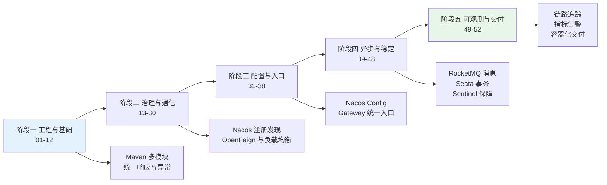
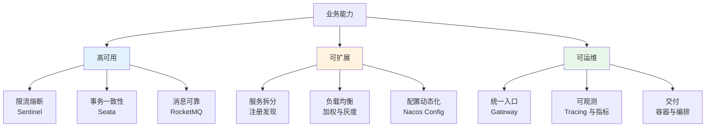
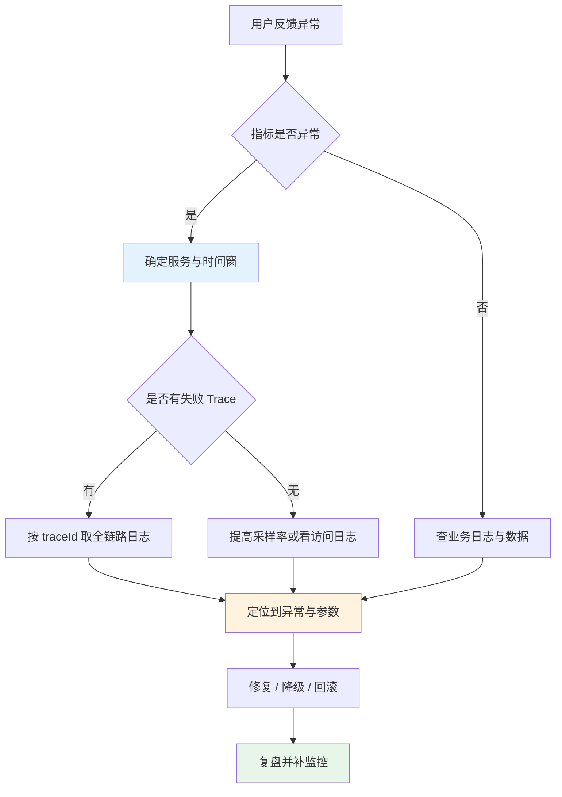
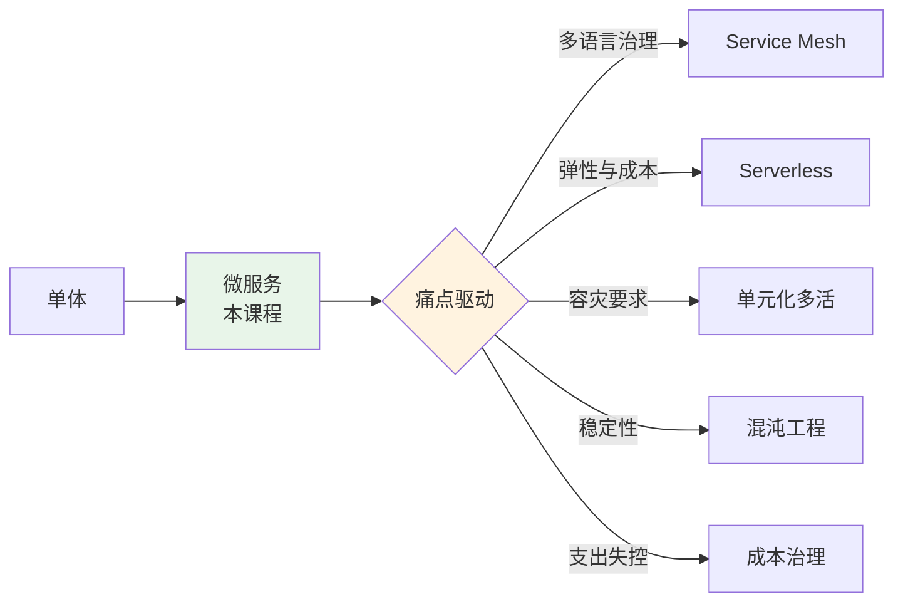

# 课程总结与架构演进路线

## 课程目标

- 能够用一张全景图说清五个阶段、核心组件与对应能力之间的关系
- 能够按 52 课索引快速定位知识点，把零散记忆整理成结构
- 能够用 L1 到 L4 的标准客观自评，找到下一步的补强方向
- 掌握九类常见故障的症状、成因与定位手段，形成固定排查路径
- 了解 Service Mesh、Serverless、多活、混沌工程、成本治理的引入条件
- 能够围绕高频面试题组织答案，讲清取舍而不只是背组件名

## 回顾与导入

第 01 课我们提了三个问题。

为什么学、怎么学、学完能做什么。

51 节课之后，这三个问题应该有答案了。

为什么学：单体在业务规模增长后会遇到构建、部署、故障隔离与协作效率的瓶颈。

微服务是取舍的结果，不是更高级的写法。

怎么学：沿着工程初始化、注册与调用、配置与入口、异步与稳定、可观测与交付五个阶段推进。

每个阶段都有可验证的交付物。

学完能做什么：把一个单体业务拆成可运行、可治理、可观测、可交付的微服务系统。

同时知道每引入一个组件要付出什么代价。

这一课不再引入新组件。

只做三件事：把知识连成网、把能力量化、把下一步说清楚。

## 全景回顾

### 五个阶段产出了什么

| 阶段 | 课时 | 解决的问题 | 交付物 | 验收方式 |
| --- | --- | --- | --- | --- |
| 工程与基础 | 01 至 12 | 单体瓶颈与工程骨架 | book-microservice 多模块工程 | 三个服务能各自跑通 CRUD |
| 治理与通信 | 13 至 30 | 服务如何找到彼此并可靠调用 | 注册发现、远程调用、负载均衡 | 订单服务能调库存，多实例可轮询 |
| 配置与入口 | 31 至 38 | 配置散落与入口不统一 | 配置中心与网关 | 改配置不重启生效，外部只进 8080 |
| 异步与稳定 | 39 至 48 | 同步链路过长、一致性无保障 | 消息、事务、限流熔断 | 下单可异步化，故障能降级 |
| 可观测与交付 | 49 至 52 | 出问题看不见、交付靠手工 | 追踪、指标告警、容器编排 | 一次请求可在 Zipkin 看全链路 |

五个阶段是串行依赖的。

没有注册中心，远程调用无处可寻；没有远程调用，网关无路由可转。

没有稳定的调用，链路追踪也只能记录一片混乱。

这也是课程不从"装一堆中间件"开始的原因。

### 三条主线

回头看，52 节课其实只在解决三条主线。

- 第一条是"找到彼此"：注册中心、远程调用、负载均衡。
- 第二条是"扛住压力"：网关、消息、事务、限流熔断。
- 第三条是"看清楚"：配置治理、链路追踪、指标告警、容器化交付。

三条主线交织在一起。

任何一条断了，系统都称不上可上线。

### 已停更组件与替代

| 已停更 | 替代方案 | 迁移要点 |
| --- | --- | --- |
| Eureka | Nacos | 换依赖与地址，注意 AP 模型差异 |
| Hystrix | Sentinel | 熔断语义不同，规则需重配 |
| Ribbon | Spring Cloud LoadBalancer | 自定义策略接口变化 |
| Sleuth | Micrometer Tracing | 换 bridge 依赖，改包名 |
| Zuul 1 | Spring Cloud Gateway | 过滤器从阻塞改为响应式 |

### 能力与组件的对应

组件不是按技术分类记住的。

要按"它替你扛住了什么"记住。

Sentinel 扛的是流量尖峰，Seata 扛的是跨库一致性。

RocketMQ 扛的是同步链路长度，Gateway 扛的是入口复杂度。

能说出每个组件扛的是什么，架构评审时就不会把组件堆成清单。

## 52 课索引

| 课时 | 主题 | 核心产出 |
| --- | --- | --- |
| 01 | 课程导言 | 学习路径与版本基线 |
| 02 | 单体系统存在的问题分析 | 识别单体的四类瓶颈 |
| 03 | 微服务架构的特性 | 理解拆分的代价 |
| 04 | 微服务架构的实施方法 | 演进而非重写 |
| 05 | 微服务架构核心组件 | 组件职责地图 |
| 06 | 微服务架构技术选型 | 选型判断依据 |
| 07 | Spring Cloud Alibaba简介 | 技术栈全景 |
| 08 | 项目案例分析：图书管理系统 | 业务模型与表设计 |
| 09 | 微服务架构与案例系统初始化 | 多模块工程骨架 |
| 10 | Spring Cloud Alibaba技术栈集成 | 依赖与版本基线 |
| 11 | 微服务拆分与接口设计 | 三个服务的接口契约 |
| 12 | 公共模块建设 | Result 与全局异常体系 |
| 13 | Nacos部署与快速上手 | 单机注册中心可用 |
| 14 | Nacos高可用集群搭建 | 三节点集群与负载 |
| 15 | 图书服务注册到Nacos | 首个服务完成注册 |
| 16 | 用户与订单服务注册 | 四服务全部注册 |
| 17 | Nacos服务发现实战 | DiscoveryClient 取实例 |
| 18 | Nacos分级模型与Namespace环境隔离 | 环境隔离落地 |
| 19 | Nacos Group分组与多环境切换 | 分组规划与切换 |
| 20 | Nacos权重路由与元数据治理 | 灰度权重与标签路由 |
| 21 | Nacos API 专题 | OpenAPI 运维自动化 |
| 22 | OpenFeign快速上手 | 声明式远程调用 |
| 23 | OpenFeign核心注解详解 | 注解与超时配置 |
| 24 | OpenFeign拦截器与上下文透传 | 用户与链路信息透传 |
| 25 | OpenFeign与LoadBalancer集成 | 客户端负载均衡 |
| 26 | 订单-图书远程调用重构 | 下单前校验库存与用户 |
| 27 | Spring Cloud LoadBalancer快速上手 | 替换默认负载策略 |
| 28 | 负载均衡算法与LoadBalancer | 算法对比与选择 |
| 29 | 自定义负载均衡策略与平滑加权轮询 | 平滑加权轮询落地 |
| 30 | 远程调用可靠性：超时、重试与幂等 | 可靠性三件套 |
| 31 | Nacos Config配置中心快速上手 | 配置集中管理 |
| 32 | 配置隔离、共享与多环境管理 | 分层与共享配置 |
| 33 | 配置动态刷新与灰度发布 | 改配置不重启生效 |
| 34 | 配置中心安全与治理实践 | 鉴权与变更审批 |
| 35 | Spring Cloud Gateway快速上手 | 统一入口 8080 |
| 36 | 路由断言工厂与过滤器 | 断言与过滤器链 |
| 37 | 网关统一鉴权与限流 | 入口鉴权与限流 |
| 38 | 网关动态路由、跨域与高可用 | 动态路由与 CORS |
| 39 | RocketMQ概述与部署 | 消息中间件就绪 |
| 40 | 消息发送与消费实战 | 下单链路异步化 |
| 41 | 顺序消息、延迟消息与事务消息 | 三类消息的用法 |
| 42 | 消息可靠性与幂等设计 | 不丢不重的保障 |
| 43 | 分布式事务理论与Seata架构 | 事务模型与角色 |
| 44 | Seata AT模式实战 | AT 模式端到端落地 |
| 45 | TCC、Saga、XA模式与选型 | 四种模式的取舍 |
| 46 | Sentinel快速上手与流量控制 | 流控规则生效 |
| 47 | Sentinel熔断降级与热点参数限流 | 熔断与热点保护 |
| 48 | Sentinel规则持久化与集群流控 | 规则不丢、集群协同 |
| 49 | Micrometer Tracing与链路追踪 | 全链路 traceId |
| 50 | 日志关联、指标监控与告警 | 可观测闭环 |
| 51 | 容器化部署与生产实践 | 一套编排跑全栈 |
| 52 | 课程总结与架构演进路线 | 能力盘点与下一步 |

> **提示：** 把这张表当成复习清单。
>
> 每天挑三课看"核心产出"，能复述实现要点就算过关。

## 能力自评

L1 到 L4 不是熟练度阶梯，而是"责任范围"的差别。

会用是能跑通，会配是能改对。

会调优是能解释数字，会设计是能做取舍。

| 组件 | L1 会用 | L2 会配 | L3 会调优 | L4 会设计 |
| --- | --- | --- | --- | --- |
| Nacos 注册 | 服务能注册、能发现 | 命名空间与分组规划 | 集群与心跳参数 | 多集群拓扑 |
| Nacos 配置 | 拉取到配置 | 共享配置与动态刷新 | 推送延迟与长轮询 | 配置治理体系 |
| OpenFeign | 接口能调通 | 超时、重试、拦截器 | 连接池与序列化 | 调用边界治理 |
| LoadBalancer | 能轮询到多实例 | 权重与灰度路由 | 平滑加权与延迟感知 | 流量调度策略 |
| Gateway | 路由转发可用 | 断言、过滤器、跨域 | 线程模型与背压 | 入口与安全边界 |
| RocketMQ | 能收发消息 | 顺序、延迟、事务消息 | 堆积定位与消费能力 | 消息模型与一致性 |
| Seata | AT 模式跑通 | 事务分组与回滚表 | 全局锁冲突与性能 | 选型与补偿设计 |
| Sentinel | 加上流控规则 | 熔断、热点、集群流控 | 阈值与系统自适应 | 稳定性与容量规划 |
| 可观测 | 能看到 traceId | 采样、指标、面板 | 基数控制与告警阈值 | 观测体系与 SLO |
| 容器化 | 能构建镜像 | compose 编排 | 资源限额与启动优化 | 流水线与多环境 |

自评的方法很简单：挑一列往下读。

凡是"没做过"的就是缺口。

大多数人会卡在 L2 到 L3 之间。

因为 L3 需要真实的流量与故障，光看课件补不上。

| 自评结果 | 典型表现 | 下一步 |
| --- | --- | --- |
| 多数停在 L1 | 跟着课件能跑通 | 不看步骤独立复现 |
| 多数在 L2 | 会配但说不清为什么 | 补原理，做压测与故障注入 |
| 半数到 L3 | 能解释指标数字 | 参与一次线上故障复盘 |
| 有若干 L4 | 能做方案取舍 | 带一个完整的改造项目 |

### 补强顺序

- L1 到 L2：把配置项逐个改错再改对，理解默认值的作用。
- L2 到 L3：跑一次压测，把面板上的数字和代码对应起来。
- L3 到 L4：做一次跨服务改造，为每个决策写下理由与代价。
- 每一级都要留产物：配置对比、压测报告、改造方案。

## 故障排查手册

排查效率取决于路径是否固定。

下面这张表按"症状"索引。

先判断属于哪一类，再按定位手段逐层收敛。

| 类别 | 典型症状 | 可能原因 | 定位手段 |
| --- | --- | --- | --- |
| 注册 | 实例列表为空或不更新 | 网络不通、命名空间或分组不一致、鉴权失败 | 看注册日志，查控制台实例列表，`curl` 注册接口 |
| 配置 | 启动报 401 或读不到配置 | 账号缺失、dataId 或 Group 写错、命名空间不匹配 | 对比控制台内容，开 DEBUG 看拉取日志 |
| 调用 | 调用超时或 404 | 服务名写错、路径前缀重复、超时过短 | 看 Feign 日志与 traceId，`curl` 直连实例 |
| 负载均衡 | 请求总打到同一实例 | 缓存未刷新、权重配置、元数据不一致 | 查实例供应器返回，核对权重与元数据 |
| 网关 | 502 或路由不生效 | 下游未注册、断言写错、路由未刷新 | 开 Gateway DEBUG，看路由匹配日志 |
| 消息 | 消费不到或重复消费 | 订阅关系不一致、消费组冲突、重试未幂等 | 查 Broker 堆积与位点，看消费日志 msgId |
| 事务 | 全局回滚但分支未回滚 | 数据源代理未生效、undo_log 缺失、TC 不可达 | 查事务状态，核对 undo_log 与分支注册 |
| 限流 | 规则不生效或误伤 | 资源名不匹配、规则未持久化、来源未识别 | 看簇点链路，核对资源名与规则来源 |
| 链路 | 链路断开或查不到 | 传播头丢失、采样未命中、上报地址错 | 手工带 `traceparent`，检查上报日志 |

这张图的价值在于顺序。

先看指标判断"有没有事、多大范围"，再看追踪取样本，最后用日志解释。

反过来先翻日志，往往会在几万行里迷失。

### 三个习惯

- 先看指标再翻日志，范围比细节重要。
- 每次排查都记下时间线，复盘时能还原决策过程。
- 修完之后补一条监控或告警，避免同类问题复发。

## 架构演进下一步

微服务不是终点。

每往下一步走，都要先满足引入条件，否则是用复杂度换麻烦。

| 方向 | 解决什么 | 引入条件 | 主要成本 |
| --- | --- | --- | --- |
| Service Mesh | 语言无关的流量治理与灰度 | 多语言服务、治理逻辑重复 | 运维复杂度、延迟增加 |
| Serverless | 极致弹性与按量计费 | 流量波动大、任务型负载 | 运行时长限制、状态管理难 |
| 单元化与多活 | 机房级容灾、就近访问 | 有容灾要求、分片方案成熟 | 数据同步、路由改造、成本翻倍 |
| 混沌工程 | 提前暴露系统性弱点 | 已有监控与应急预案 | 演练风险、组织协调成本 |
| 成本治理 | 控制资源与存储支出 | 账单可见、有分摊口径 | 持续投入与考核机制 |
| 事件驱动架构 | 解耦削峰、跨域协作 | 业务可接受最终一致 | 一致性设计与消息治理 |

> **结论：** 判断标准不是"别人有没有"，而是"当前痛点是否已经无法用现有手段解决"。
>
> 没有痛点就上 Mesh，通常换来更长的故障定位时间。

### 引入前的五个问题

- 现有手段为什么不够用了？
- 引入后谁负责运维，出问题找谁？
- 回滚路径是什么，回滚要多久？
- 团队里有没有人真的懂它？
- 成本增加多少，收益怎么衡量？

五个问题答不上三个，就先别引入。

## 面试高频问题

以下 20 个问题覆盖了本课程的主要取舍点。

答案要点只给骨架，讲的时候要结合自己做过的场景。

| 序号 | 问题 | 答题要点 |
| --- | --- | --- |
| 1 | 为什么从单体拆到微服务 | 构建、部署、隔离、协作四类瓶颈；代价是一致性与运维复杂度 |
| 2 | 微服务拆分依据 | 业务能力与限界上下文；先粗后细；不按技术分层拆 |
| 3 | Nacos 的 AP 与 CP 区别 | 临时实例走 AP 保可用，持久实例走 CP 保一致 |
| 4 | Nacos 配置推送如何实现 | 长轮询挂起请求，有变更立即返回，超时重连 |
| 5 | 注册中心选型看什么 | 一致性、规模、生态、运维成本四维对比 |
| 6 | OpenFeign 的调用流程 | 代理生成请求、编码、选实例、拦截器、解码 |
| 7 | 超时与重试怎么设 | 超时按 P99，重试只对幂等接口，次数与退避有限 |
| 8 | 为什么要做幂等 | 重试与消息重投必然重复；唯一键、状态机、去重表 |
| 9 | 常见负载均衡算法 | 轮询、随机、加权、最少连接、一致性哈希 |
| 10 | 平滑加权轮询解决什么 | 避免固定顺序造成的瞬时倾斜，权重在每轮均匀分布 |
| 11 | 网关的定位 | 入口、鉴权、限流、路由、灰度；不放业务逻辑 |
| 12 | 网关如何限流 | 令牌桶或漏桶，按路由或用户维度，集群需共享计数 |
| 13 | 消息如何保证不丢 | 生产确认、刷盘与副本、手动 ACK、重试与死信 |
| 14 | 顺序消息怎么做 | 同一业务键进同一队列，消费端单线程或按键加锁 |
| 15 | 分布式事务有哪些方案 | 2PC、AT、TCC、Saga、本地消息表，按一致性选 |
| 16 | Seata AT 的原理 | 解析 SQL 生成前后镜像，注册分支，异常时按镜像回滚 |
| 17 | 熔断与限流的区别 | 限流控入口速率，熔断隔离不稳定依赖 |
| 18 | 如何定位跨服务慢请求 | 指标定范围、追踪找慢 Span、日志看参数 |
| 19 | 如何设计一次灰度发布 | 流量切分、实例分组、观测指标、回滚开关 |
| 20 | 微服务下如何做容量规划 | 压测基线、峰值系数、资源水位、扩容阈值 |

> **提示：** 面试官更在意"你为什么这么选"。
>
> 补一句"不这么做会怎样"更有说服力。

## 继续实践建议

### 改造自己的项目

拿一个熟悉的单体系统。

按课程顺序改造，不要跳步：

1. 先做接口梳理与模块拆分，跑通三个服务各自的 CRUD。
2. 接入注册中心与远程调用，把跨库查询改成服务调用。
3. 补网关与配置中心，让外部只从一个入口进。
4. 挑一条链路做异步化与事务改造，体会最终一致的代价。
5. 最后补限流、熔断与可观测，做一次故障演练。

每一步都要留下证据。

注册列表、改配置不重启的日志、Zipkin 调用树、告警触发记录。

### 读源码的顺序

| 顺序 | 目标 | 关注点 |
| --- | --- | --- |
| 1 | Nacos 客户端注册流程 | 心跳、实例封装、失败重试 |
| 2 | OpenFeign 代理生成 | 注解解析、请求模板、编码器 |
| 3 | LoadBalancer 选择过程 | 实例供应、过滤器链、缓存 |
| 4 | Gateway 过滤器链 | 路由匹配、全局过滤器顺序 |
| 5 | Sentinel 责任链 | 槽位顺序、滑动窗口统计 |
| 6 | Seata 数据源代理 | SQL 解析、镜像生成、分支注册 |

按调用顺序读，遇到看不懂的方法先记名字继续往下。

读完主线再回头补细节。

### 压测与演练

- 用 `wrk` 或 `jmeter` 做基线压测，先跑出单实例 QPS 与 P99。
- 用 Sentinel 或 `tc` 注入延迟与异常，观察熔断是否按预期生效。
- 主动停掉一个 Nacos 节点、一个 Broker，记录降级行为。
- 每次演练写清"注入什么、期望什么、实际什么"。

### 学习节奏建议

- 每学完一个模块，把案例系统的对应能力补齐，不要只跑示例。
- 遇到配置项，先查它默认值与不配置时的行为。
- 每两周做一次复盘，把踩过的坑写成自己的排查清单。
- 不要同时学两套技术栈，先把一套跑通再横向对比。

### 三个月的节奏

1. 第一个月：完成工程拆分与注册调用，跑通主链路。
2. 第二个月：补网关、配置中心与消息，做一次异步化改造。
3. 第三个月：补可观测与容器化，做一次故障演练并复盘。

## 注意事项

1. **不要为了用组件而用组件**：每个组件都要回答"不用它会怎样"。
2. **分布式不是免费的**：多一次网络调用就多一种失败可能。
3. **一致性要与业务确认**：最终一致是业务能否接受的问题。
4. **配置与代码要能分开回滚**：混在一起只能整包回退。
5. **监控要在上线前就位**：先有观测再放流量。
6. **容量要按峰值估**：按均值规划，第一次大促就会打穿。
7. **文档与演练同样重要**：没演练过的预案等于没有预案。
8. **复盘要落到改动上**：没有产出改动的复盘，下次还会踩同一个坑。

## 小结

本节课我们学习了：

1. **全景回顾**：五个阶段串成一条依赖链，每段都有交付物与验收方式。
2. **52 课索引**：按"核心产出"复述每一课，是成本最低的复习方式。
3. **能力自评**：用 L1 到 L4 定位缺口，L3 之后必须靠真实流量与故障进阶。
4. **排查手册**：九类症状对应九条路径，顺序是先指标、再追踪、后日志。
5. **演进路线**：Mesh、Serverless、多活、混沌工程、成本治理都有前置条件。
6. **面试表达**：讲清取舍与代价，比背参数更能体现架构能力。
7. **继续实践**：改造项目、按调用顺序读源码、用压测与演练验证认知。
8. **下一步**：把课程能力映射回自己的项目，按三条主线逐项查漏。

## 作业

### 作业一：写一份自己的架构自评报告

1. 对照《能力自评》表，为注册配置、远程调用、负载均衡、网关、消息、事务、限流、可观测八类能力各打一个等级（L1 至 L4），并写明判断依据。
2. 挑出等级最低的两项，各写一条"下一周就能完成"的具体提升动作（例如：把 Sentinel 规则持久化到 Nacos 并做一次压测验证）。
3. 用 300 字向非技术同事解释你负责的这套系统由哪些部分组成、最怕什么样的故障。

### 作业二：给 book-microservice 做一次故障演练

1. 按《故障排查手册》任选两类症状，实际制造故障（停掉一个 book-product 实例 / 清空 Redis 中商品缓存 / 让 Nacos 命名空间写错）。
2. 记录：现象、你用到的定位命令或端点、从发现到恢复的耗时、最终改动。
3. 为每个故障补一条可自动化的告警规则草案（PromQL 或日志关键字均可）。

### 作业三：规划下一阶段的演进

1. 从《架构演进下一步》中选择一个方向（Service Mesh / Serverless / 单元化多活 / 混沌工程 / 成本治理），写出引入的三个前置条件与两个不引入的理由。
2. 画一张你所在项目当前架构与目标架构的对比图（mermaid），标注每个阶段要新增的组件与验证指标。
3. 按 ADR 格式（背景、候选方案、决策、后果）记录你这次的选型结论。

## 结语

52 节课走完，你手里应该有一套能跑起来的系统，还有一张知道每个组件为什么在那里的地图。

这两样东西比记住一百个配置项更有用：配置会随版本变化，判断力不会。

课程里反复出现的模式只有几个。

先想清楚要解决什么，再选最小的手段。

引入任何组件都要准备回滚。

把可观测性当成功能，而不是附加项。

把"能跑通"和"能上生产"当成两件事。

真实的生产环境比课件复杂得多。

流量、数据、人的因素都不在代码里。

但排查的路径、取舍的方法、验证的习惯可以迁移，这才是这门课真正的产出。

课程到这里结束，工程还要继续。愿你下次遇到线上问题时，第一反应不是重启，而是打开面板。
